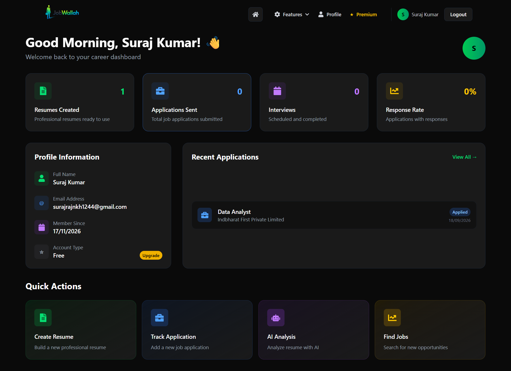
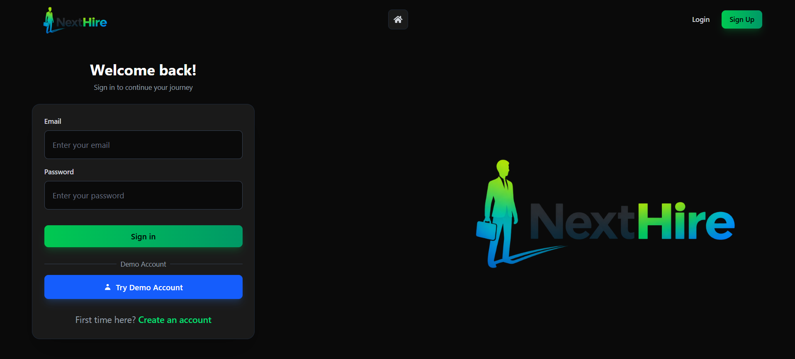
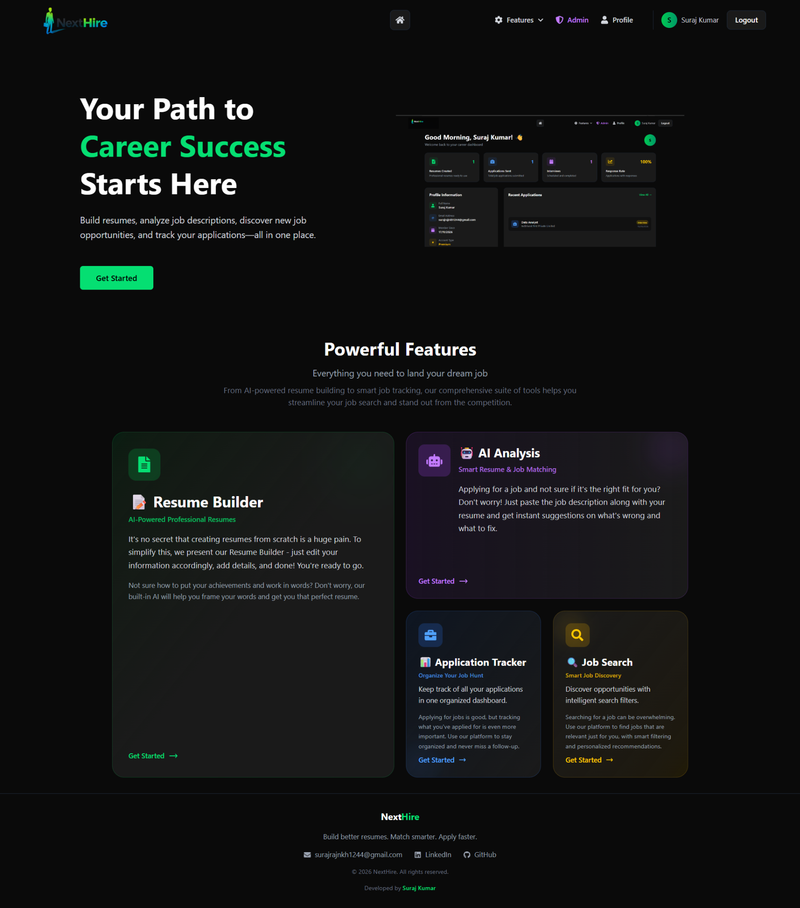
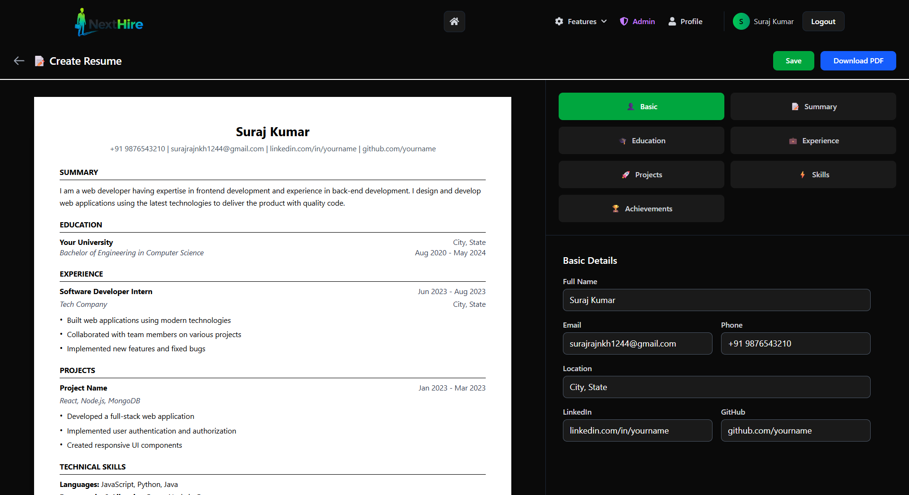
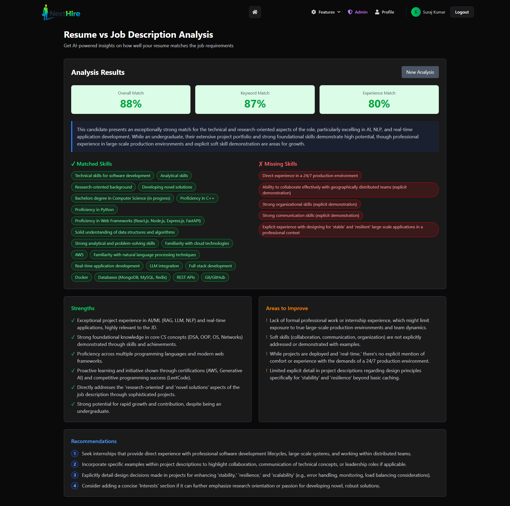
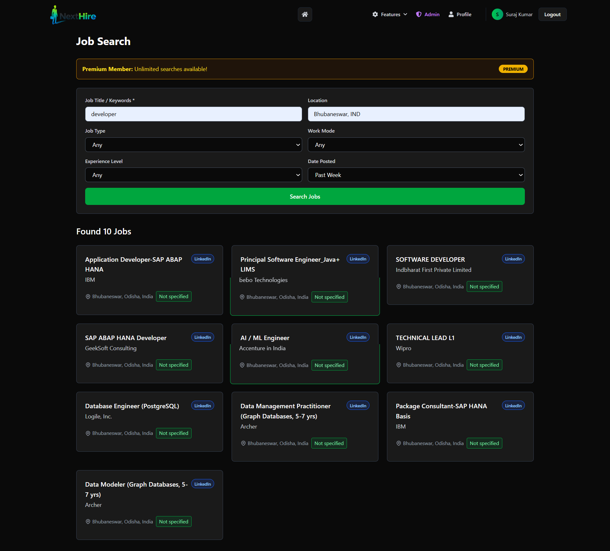
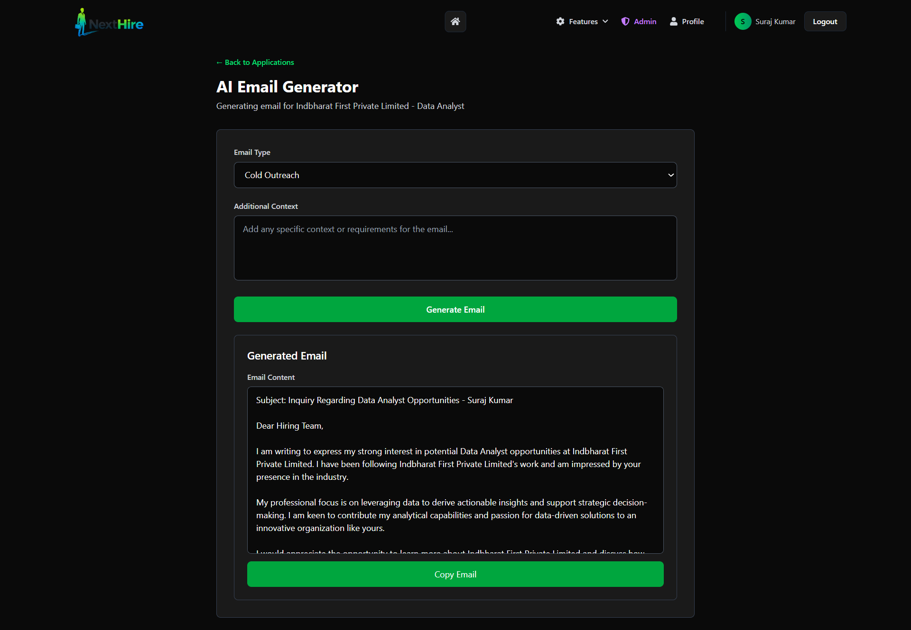
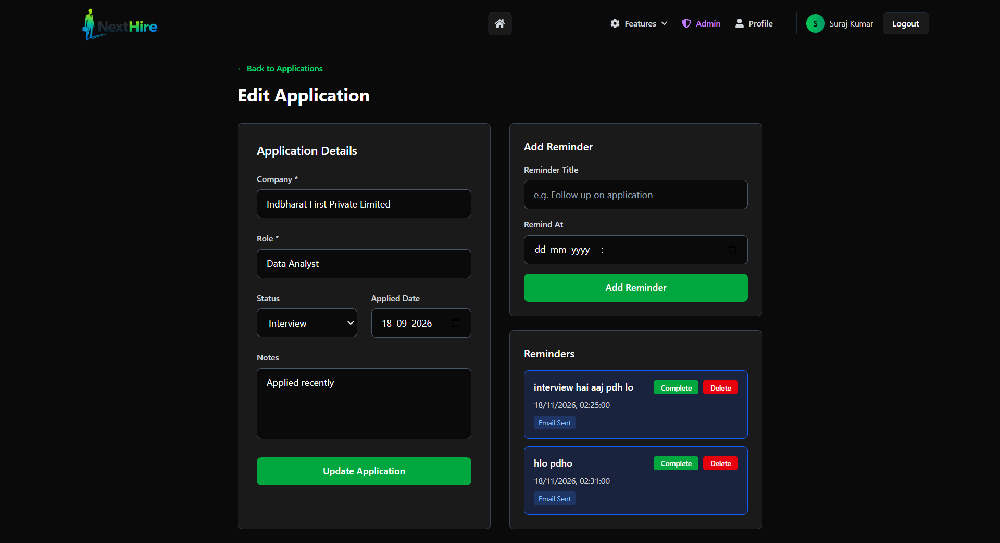
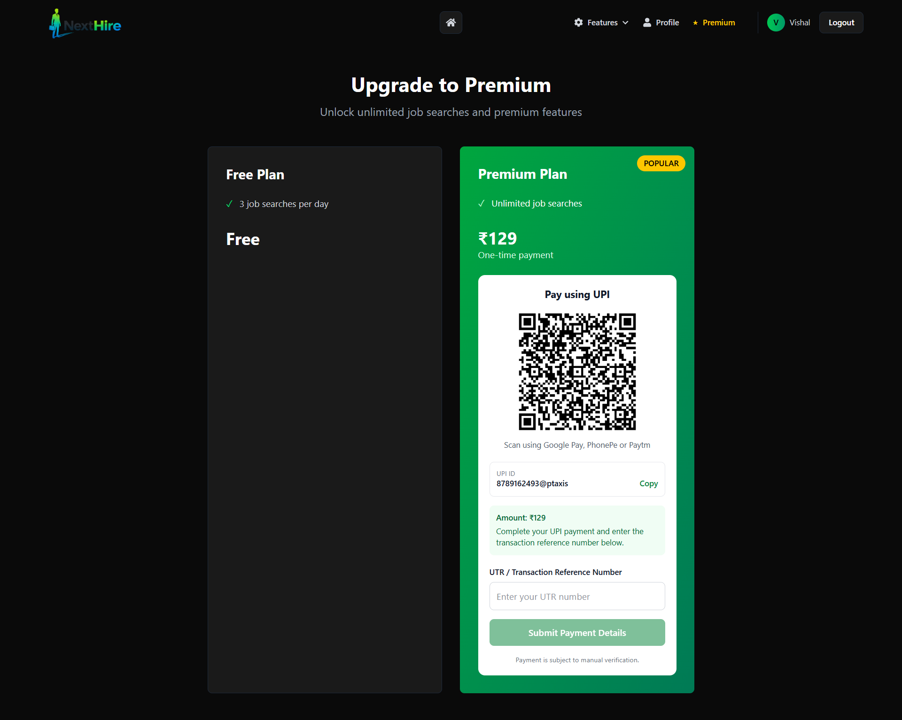
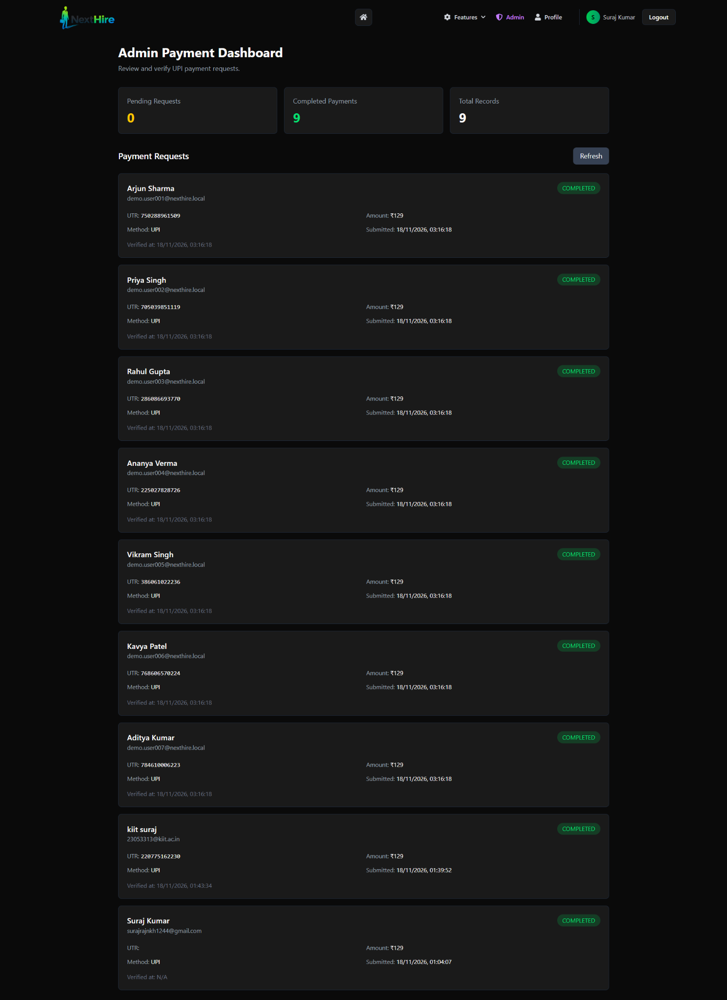

# NextHire — Your Path to Career Success

<p align="center">
  <strong>Build better resumes. Match smarter. Apply faster.</strong>
</p>

<p align="center">
  A full-stack career productivity platform for resume building, AI-assisted career tools, job discovery, application tracking, and reminders.
</p>

<p align="center">
  
  
  
  
  
</p>

---

## Overview

**NextHire** is a MERN-stack job-search management platform. It brings resume creation, AI-powered resume feedback, job-description matching, job discovery, application tracking, reminder emails, and premium membership into one application.

## Application Screenshots

### 1. Landing Page
The public home page introduces NextHire and highlights its main career tools.



### 2. Login
Users can sign in to access their career dashboard. A demo-account option is also available in the shown interface.



### 3. User Dashboard
The dashboard summarizes resumes, applications, interviews, response rate, profile information, recent applications, and quick actions.



### 4. Resume Builder
Create and edit a structured resume with sections for personal details, summary, education, experience, projects, skills, and achievements. Preview and download the resume.



### 5. AI Resume vs. Job Description Analysis
Compare a resume with a job description and review the overall match, keyword match, experience match, matched skills, missing skills, strengths, and recommendations.



### 6. Job Search
Search job opportunities using keywords and filters such as location, job type, work mode, experience level, and date posted.



### 7. AI Email Generator
Generate a tailored professional email draft using the selected email type and additional context. The generated content can be reviewed and copied.



### 8. Application Reminders
Add reminders to an application with a title and scheduled date/time. The reminder interface displays email-delivery status and provides completion and delete actions.



### 9. Premium Subscription
View the free and premium plans, initiate a UPI payment using the displayed QR code, and submit the transaction reference number for manual review.



### 10. Admin Payment Dashboard
Administrators can review submitted payment references and payment records. Payment approval is a manual process.



---

## Features

- **Resume Builder:** Create, edit, preview, save, and download structured resumes.
- **AI Resume Analysis:** Get AI-assisted feedback on resume content.
- **Resume–JD Matching:** Compare a resume against a job description and identify matching and missing skills.
- **Job Search:** Discover job listings with search filters.
- **Application Tracker:** Organize applications, update their statuses, and view dashboard statistics.
- **AI Email Generator:** Generate professional, context-aware email drafts.
- **Smart Reminders:** Schedule application reminders and send email notifications.
- **Premium Membership:** UPI-based premium payment submission.
- **Admin Dashboard:** Review payment submissions and manually verify transactions.

## Tech Stack

| Layer | Technologies |
|---|---|
| Frontend | React, React Router, Tailwind CSS |
| State Management | Zustand |
| API Communication | Axios |
| Backend | Node.js, Express.js |
| Database | MongoDB, Mongoose |
| Authentication | JWT, cookies, bcrypt |
| AI Integration | Google Gemini API |
| Scheduled Tasks | node-cron |
| Email | Nodemailer, Gmail SMTP |
| Supporting Tools | Git, GitHub, Postman, dotenv |

## Project Structure

```text
next-hire/
├── backend/
│   ├── config/
│   ├── controllers/
│   ├── middleware/
│   ├── models/
│   ├── routes/
│   ├── utils/
│   ├── index.js
│   └── seed.js
├── frontend/
│   ├── public/
│   └── src/
│       ├── assets/
│       ├── components/
│       ├── pages/
│       └── store/
└── docs/
    └── screenshots/
```

*This is a high-level overview; exact folders may vary with the current codebase.*

## Getting Started

### Prerequisites

- Node.js and npm
- MongoDB database (local MongoDB or MongoDB Atlas)
- Google Gemini API key for AI features
- Gmail App Password for reminder emails (optional if email reminders are not used)

### 1. Clone the repository

```bash
git clone https://github.com/Suraj1307/next-hire.git
cd next-hire
```

### 2. Install backend dependencies

```bash
cd backend
npm install
```

### 3. Configure backend environment variables

Create `backend/.env` and provide the values required by your backend configuration. Example:

```env
PORT=5000
MONGO_URI=your_mongodb_connection_string
JWT_SECRET=your_jwt_secret
FRONTEND_URL=http://localhost:5173
EMAIL_USER=your_gmail_address
EMAIL_PASS=your_gmail_app_password
GEMINI_API_KEY=your_gemini_api_key
```

Check the code for the exact environment-variable names used by your installed version. Never commit `.env` files or credentials.

### 4. Install frontend dependencies

Open a second terminal:

```bash
cd frontend
npm install
```

### 5. Start the application

Start the backend using the script defined in `backend/package.json` (for example, `npm run dev` or `npm start`). In a second terminal, start the frontend:

```bash
cd frontend
npm run dev
```

Open the local URL printed by Vite.

## Demo Data

An optional `backend/seed.js` script is available for creating sample users and related records. Run it only against a local or dedicated development database:

```bash
cd backend
node seed.js
```

Seeded payment records are demonstration data, not real transactions. Do not use them as real payment or revenue records, and do not run the seeder against production data.

## Important Payment Note

The premium flow accepts a UPI transaction reference (UTR) for **manual verification**. A submitted UTR is not automatically verified against a bank or UPI provider. An administrator must check the actual transaction before approving premium access.

## Security Notes

- Keep API keys, database credentials, JWT secrets, and Gmail App Passwords in environment variables.
- Ensure `.env` files are excluded from version control.
- Use a Gmail App Password rather than your regular Gmail password when configuring Gmail SMTP.
- Treat seeded users and payment records as test data.

## Tested Workflows

During local development, the following workflows were exercised:

- Signup, login, and protected user access.
- Resume creation, editing, preview, and download.
- AI-powered resume and job-description analysis.
- Job search and application tracking.
- AI email draft generation.
- Reminder scheduling and Gmail SMTP delivery.
- UPI payment submission and admin-side manual verification flow.

## Future Improvements

- Add automated tests for critical API and UI workflows.
- Use durable cloud storage for uploaded files before production deployment.
- Use a production-ready email provider and scheduler for deployed environments.
- Add a payment gateway if automated payment confirmation is required.

## Author

**Suraj Kumar**

- GitHub: [@Suraj1307](https://github.com/Suraj1307)
- LinkedIn: [Suraj Kumar](https://www.linkedin.com/in/suraj-kumar-a59915285/)
- Email: [surajrajnkh1244@gmail.com](mailto:surajrajnkh1244@gmail.com)

---

<p align="center">
  <strong>NextHire — Build better resumes. Match smarter. Apply faster.</strong><br />
  Made with ❤️ by Suraj Kumar
</p>
